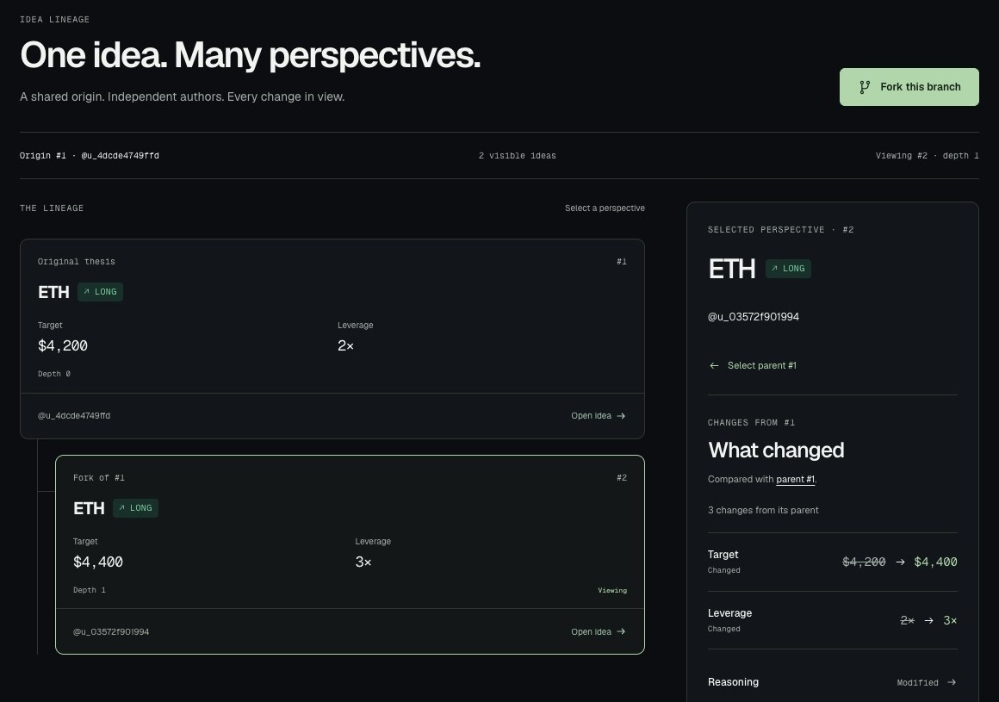

# FORK

**Trading ideas evolve here.**

The social network where trading ideas can be published, forked and improved without losing their history.

[Live product](https://forktrades.xyz) · [Explore the real Idea Tree](https://forktrades.xyz/t/2/tree) · [Source](https://github.com/anilkaracay/fork-metropolis)



## An improvement should have a history

A trading idea starts in a timeline. Someone changes the target, challenges the leverage or improves the reasoning. That contribution disappears inside replies and screenshots.

FORK gives the improvement its own identity. Publish an idea. Fork it with a different approach. Keep the parent, original author and new author visible. Open the Idea Tree to understand how the idea evolved.

## Follow one real contribution

| Step | What you can inspect |
| --- | --- |
| [Original #1](https://forktrades.xyz/t/1) | ETH long; target **4200**, invalidation **3600**, leverage **2×**. |
| [Fork #2](https://forktrades.xyz/t/2) | A second author changes the target to **4400**, leverage to **3×** and the reasoning. |
| [Idea Tree](https://forktrades.xyz/t/2/tree) | Parent → child lineage, independent authorship and comparison with the immediate parent. |
| [Original author](https://forktrades.xyz/u/u_4dcde4749ffd) · [Fork author](https://forktrades.xyz/u/u_03572f901994) | Contributions and influence with explicit formulas and **Emerging** labels for the small sample. |

These are two real users and one real fork, published on Monad Testnet and indexed by Envio. Root #1 has one Agree and one visible comment. This is a working demonstration, not a claim of adoption or trading performance.

## A social contribution graph

The primary action is **Fork**. Feed and Explore help readers discover ideas; the tree preserves credit when another author contributes. Profiles distinguish original work, useful contributions and downstream influence rather than hiding them in one score.

This is our fit for **Monad Metropolis, Track 03 — Social, Attention & Culture**: collaborative creation, public attribution and persistent community knowledge. Trading supplies the subject; idea evolution supplies the social interaction. Creator incentives are a future possibility. No token, economic rewards or revenue sharing are live.

## Why Monad

Authorship and parent references need a shared record beyond a single application's database. A user's embedded EVM wallet publishes to the non-upgradeable FORKRegistry on Monad Testnet. Envio turns those events into a graph the product can read.

Monad's fast settlement and low-cost transactions suit small, frequent social contributions. This prototype proves real publication and lineage on chain **10143**; it does not claim a measured throughput or latency benchmark.

## Public technical proof

| Artifact | Reference |
| --- | --- |
| Registry | [`0x1889a7216b1ecad9a44910dd0996834d0894b9e1`](https://testnet.monadvision.com/address/0x1889a7216b1ecad9a44910dd0996834d0894b9e1) |
| Deployment | [Transaction](https://testnet.monadvision.com/tx/0xc1ba5d4fc31bc0a45e973ec8a63c0583a3fb4f643c0f46053a7ee5dd5fbf4a86) · [Deployment artifact](contracts/deployments/10143.json) |
| Original #1 | [ThesisCreated transaction](https://testnet.monadvision.com/tx/0xbcbfa028b4078a97cf1198d4ffac2f61691d8ac0607b43a006a6595b630a090f) |
| Fork #2 | [ThesisCreated transaction](https://testnet.monadvision.com/tx/0xe5fbf9c835109a566be8afebd5c2d146731d1f998851ea1875798e328ab6b192) |
| Indexed graph | [Public Envio GraphQL endpoint](https://indexer.dev.hyperindex.xyz/da86abe/v1/graphql) · [Config](indexer/config.yaml) · [Schema](indexer/schema.graphql) · [Handlers](indexer/src/handlers/registry.ts) |
| Source verification | [Recorded Sourcify exact-match result](docs/evidence/phase3/MONAD.md#source-verification) |

The [submission evidence](docs/submission/README.md) records current checks, videos and release status. Historical gate reports describe what was true at their observation time; the current product is the social MVP above.

## Architecture and trust


Privy authenticates the user and supplies the embedded wallet. The server verifies the Privy identity and authoritative wallet association before accepting mutations. Wallet approvals and blockchain signatures remain with the user.

FORKRegistry records onchain authorship, parent references and metadata commitments. PostgreSQL holds identity associations, thesis metadata, Agree and comments; **comments are offchain**. Metadata is checked against the indexed commitment before presentation as trusted. Envio indexes registry events and derived lineage; it does not independently verify trade execution.

## What works today

- Google sign-in, persistent embedded EVM wallet and server-side ownership verification.
- Signed original and fork publication, receipt confirmation and indexed discovery.
- Feed, bounded Explore search/filtering, thesis detail and parent comparison.
- First-class Idea Tree with mobile and keyboard access.
- Agree, comments and deterministic contributor profiles.
- Self-hosted HTTPS application, standard PostgreSQL and committed Drizzle migrations.
- Explicit loading, unavailable and retry states. Public development/test routes fail closed.

| Integration | Current use |
| --- | --- |
| **Privy** | Real authentication **and embedded-wallet signing** for Monad publications. Beyond login-only use. |
| **Envio HyperIndex** | Live registry-event indexing powers Feed, lineage and derived graph data. |
| **Monad Testnet** | Deployed, source-verified registry and actual original/fork transactions. |
| **Perpl** | **Deferred** pending Origin approval. No real execution or automation-bounty eligibility claimed. |
| **Nansen** | **Deferred**; provider API access unavailable. No active enrichment claimed. |

## Run and reproduce

Prerequisites: **Node 24.21.0**, **pnpm 12.6.0**, Git and the usual build tools. Docker is needed for live local PostgreSQL; Playwright needs its browser; the Foundry installer supplies the pinned contract tools. Dependencies are pinned in `pnpm-lock.yaml`.

### 1. Isolated automated workspace

This mode uses explicitly labeled test identities, simulated chain receipts and the real indexer handlers. It requires no Privy, database or trading credentials and does **not** prove live-provider integration.

```sh
git clone https://github.com/anilkaracay/fork-metropolis.git
cd fork-metropolis
pnpm install --frozen-lockfile
pnpm tools:install
pnpm --filter @fork/web exec playwright install chromium
pnpm test
pnpm lint
pnpm typecheck
pnpm test:e2e
```

For an interactive isolated workspace, run `pnpm test:dev` and open `http://localhost:3000`. Port 3000 must be free. The production environment rejects this test mode.

### 2. Real development integration

```sh
cp apps/web/.env.example apps/web/.env.local
pnpm db:up
pnpm db:migrate
pnpm db:smoke
pnpm dev
```

`db:up` generates a local password and securely writes the standard PostgreSQL connection string into ignored `.env.local`. Use the **committed migrations**, never schema push. Add your Privy app ID and server secret locally and permit `http://localhost:3000` in that app. Supply `FORK_REGISTRY_ADDRESS` and `FORK_ENVIO_URL` for real reads; publishing requires testnet MON and wallet approval. See the safe [environment example](apps/web/.env.example), [testing guide](docs/17_TESTING_QA.md) and [database scripts](scripts/local-db.mjs).

Live provider authentication cannot be reproduced without provider access. Nansen and Perpl are unnecessary for the current social journey. Never place server secrets in `NEXT_PUBLIC_*` variables.

### 3. Hosted production

Browse [forktrades.xyz](https://forktrades.xyz) without credentials. The deployed Node application runs behind Caddy HTTPS; app and PostgreSQL ports remain private. Production uses the same standard PostgreSQL driver and migrations. See [deployment instructions](deploy/README.md), without copying runtime credentials or database exports.

## Security and practical limits

No private wallet or Perpl signing keys belong on the server. Privy secrets and database credentials stay server-only and outside Git. Production proof uses existing records; it does not create activity to inflate the demo.

The live graph currently has two theses. Explore searches the latest 500 indexed ideas, not unbounded history. Reputation samples below three remain Emerging. Intermittent provider reads can fail; visible Retry and retained successful data aid recovery. There is no verified trading outcome, profit claim or active incentive mechanism.

## Team, provenance and AI assistance

Built by [anilkaracay](https://github.com/anilkaracay), the repository's sole recorded author. The retained commit history begins **October 4, 2026**, inside the Metropolis build window. No earlier FORK product or imported product code is evidenced in that history; the human owner confirms ownership and any work outside Git before final submission.

OpenAI Codex assisted implementation, testing, documentation and submission preparation. The human owner directed the build and reviewed the product and infrastructure gates. Third-party frameworks, libraries, provider services and fonts retain their own licenses and attribution; see [THIRD_PARTY_NOTICES.md](THIRD_PARTY_NOTICES.md). An open-source license is pending the owner's confirmation of rights before public release.

## Next

Run a small, invited trader-community pilot and learn whether people return to contribute useful alternatives. Improve reliability based on those observations. Complete independent execution verification when provider access permits; evaluate incentives only after the social behavior is validated.
