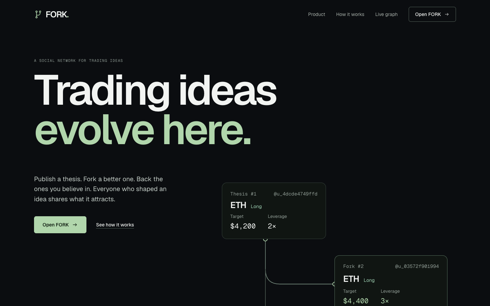
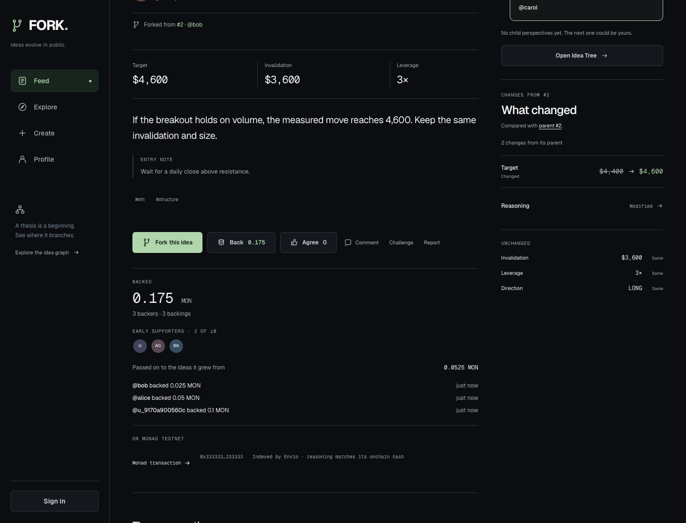
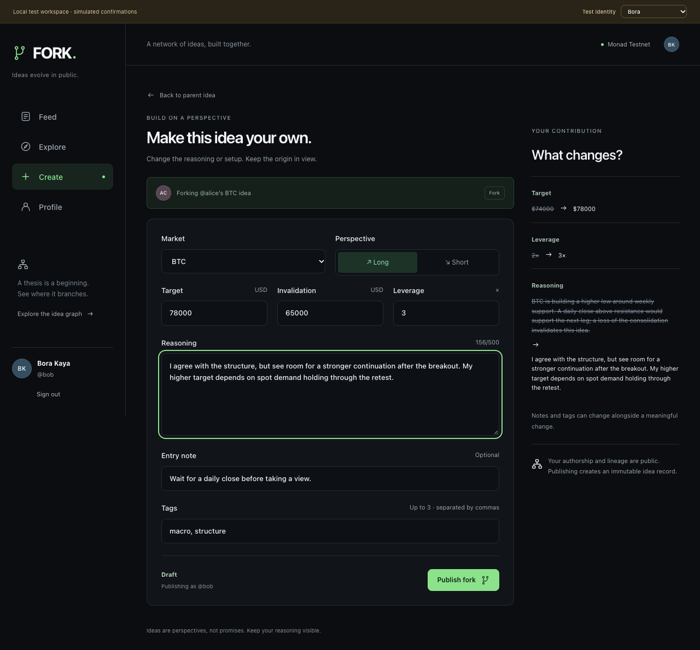
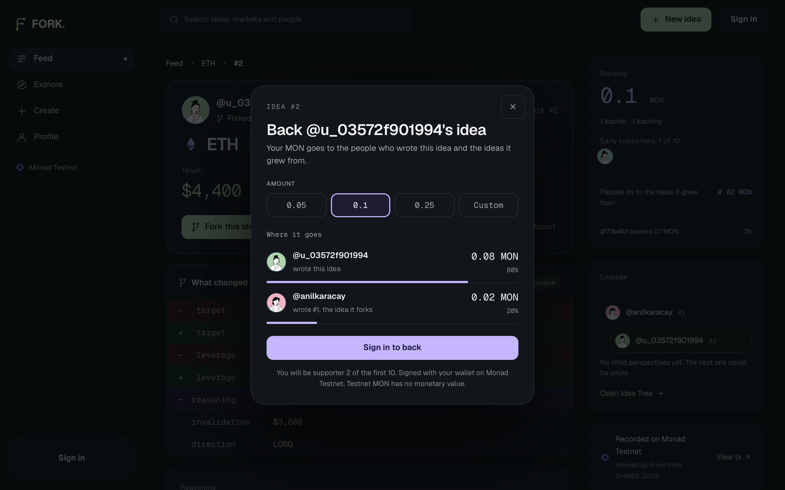
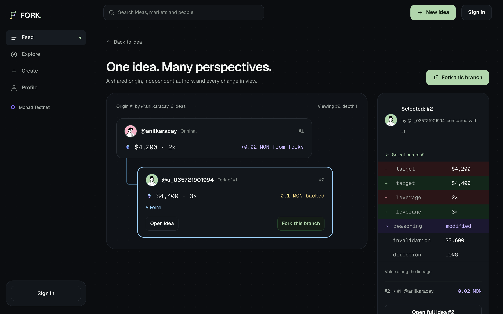
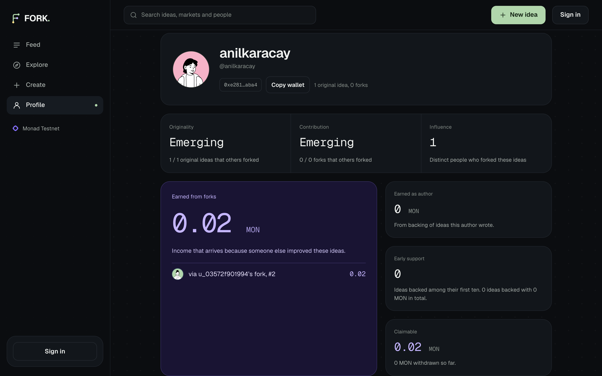
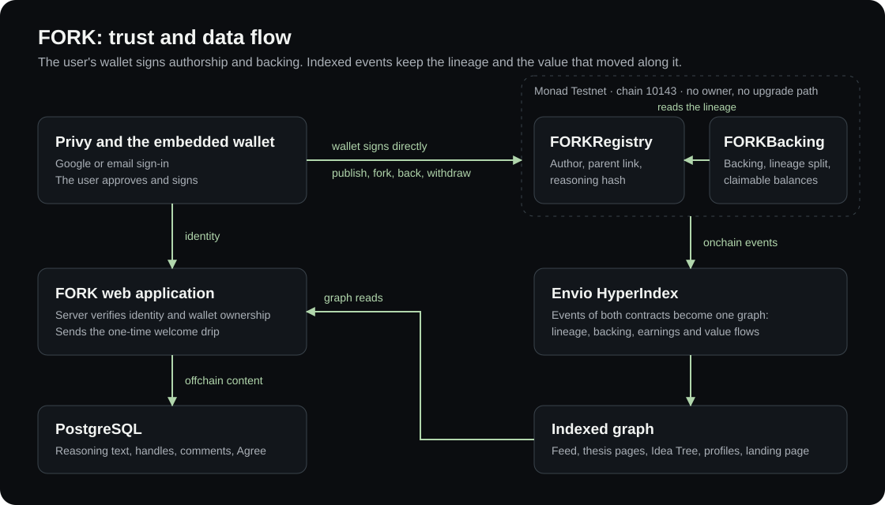

# FORK

**Trading ideas evolve here.**

Publish a trading idea. Let someone fork it into a better one. Back the ones you believe in, and the backing is shared by everyone who shaped the idea.

[Live product](https://forktrades.xyz) · [The real Idea Tree](https://forktrades.xyz/t/2/tree) · Demo video (link pending) · Founder pitch (link pending) · Pitch deck (link pending)

<!-- PENDING: demo video, founder pitch and pitch deck links -->



## The problem

Trading ideas live in X threads, Telegram groups and Discord channels. Someone posts a view. Someone else replies with a better target, a tighter invalidation or a sharper argument. That improvement is the most valuable thing in the thread, and it disappears into the replies. A week later nobody can say who changed what. The original author loses the credit for starting it, and the person who improved it never shares in the attention the idea gets.

FORK is for crypto-native traders and research groups who already explain their ideas in public, and for the people who make those ideas better.

## Why they would move

- **An idea becomes an object with a history.** A thesis has an author, a target, an invalidation, a leverage and a written argument. It has a permanent address, not a place in a scroll.
- **Forking credits the original.** A fork is a new thesis that keeps a link to its parent. The original author stays visible on every descendant.
- **Backing pays the whole lineage.** When someone backs an idea, the amount is split between its author and the authors of the ideas it grew from. Originating an idea and improving one are both paid, by the same rule, in public.

A thread cannot do the third thing at all, and it does the first two badly.

## How it works

### Publish

Write a thesis: market, direction, target, invalidation, leverage and your reasoning. Your wallet signs it and Monad records you as the author. The thesis page puts the two things a reader can do with an idea side by side: fork it or back it.



### Fork

Disagree with the target, the leverage or the argument? Fork the thesis and change it. While you write, FORK shows exactly what differs from the parent, and the published fork keeps that link for good.



### Back

Put MON behind an idea you believe in. Before you sign, the sheet shows who receives what. After it confirms, it shows the confirmation time measured for your transaction and your position among the idea's first ten backers.



### Idea Tree

Every branch of an idea in one view: who wrote it, what changed, what each version received, and what backing of its forks sent back to it.



A profile then answers what a reputation should: how many original ideas, how many were forked by other people, how much was earned as an author, how much arrived from other people's forks, and which ideas this person backed early.



_The landing page above shows the live graph. The other screenshots come from the isolated test workspace, which is labelled in its top bar and uses test identities._

<!-- PENDING: replace the test workspace screenshots with live ones after the first live backing -->

## What lives onchain and why

Two small contracts on Monad Testnet (chain 10143). Neither has an owner, an admin, a fee or an upgrade path.

| Contract | Address | What it holds |
| --- | --- | --- |
| `FORKRegistry` | [`0x1889a7216b1ecad9a44910dd0996834d0894b9e1`](https://testnet.monadvision.com/address/0x1889a7216b1ecad9a44910dd0996834d0894b9e1) | Every thesis: author, parent, market, direction, target, invalidation, leverage, creation time and the hash of its written reasoning |
| `FORKBacking` | Not deployed yet. The address is recorded here at deployment | Backing of a thesis, the split along its lineage, early supporter positions and each author's claimable balance |

<!-- PENDING: FORKBacking address, deployment transaction, block and first backing transaction -->

| Transaction | Hash |
| --- | --- |
| Registry deployment | [`0xc1ba5d4f…5fbf4a86`](https://testnet.monadvision.com/tx/0xc1ba5d4fc31bc0a45e973ec8a63c0583a3fb4f643c0f46053a7ee5dd5fbf4a86) |
| Thesis #1 published | [`0xbcbfa028…630a090f`](https://testnet.monadvision.com/tx/0xbcbfa028b4078a97cf1198d4ffac2f61691d8ac0607b43a006a6595b630a090f) |
| Thesis #2 forks #1 | [`0xe5fbf9c8…8ab6b192`](https://testnet.monadvision.com/tx/0xe5fbf9c835109a566be8afebd5c2d146731d1f998851ea1875798e328ab6b192) |

**The split.** `back(thesisId)` reads the lineage from the registry, at most three entries, and credits:

| Backed thesis | Its author | Parent's author | Grandparent's author |
| --- | --- | --- | --- |
| An original idea | 100% | | |
| A fork | 80% | 20% | |
| A fork of a fork | 70% | 20% | 10% |

- The credits of one backing always sum to the amount sent. Rounding dust goes to the author.
- One address in several roles is credited once, in its nearest role. Forking your own idea therefore never produces income labelled as earned from forks.
- Credits are balances, not transfers. Each author collects with `withdraw()`, so nobody can block a backing by refusing to receive it.
- The first ten distinct backers of a thesis are recorded as its early supporters, in arrival order.
- The minimum backing is 0.01 MON, and an author cannot back their own thesis from the authoring address.

**Why this has to be onchain.** If authorship, ancestry and the split lived in our database, credit would depend on us. Here the same public record that says who wrote an idea also decides who is paid when it is backed, and anyone can check it without asking FORK.

**What stays offchain.** The written reasoning, tags, comments and Agree reactions are in PostgreSQL. The reasoning is anchored: its hash is in the registry, and the product does not show text that fails to match it.

The contract specification is in [`docs/08_SMART_CONTRACT_SPEC.md`](docs/08_SMART_CONTRACT_SPEC.md), deployment records in [`contracts/deployments/`](contracts/deployments/), and tests, coverage and gas in [`docs/FORKBACKING_COVERAGE.md`](docs/FORKBACKING_COVERAGE.md).

## Why Monad

Backing is a social gesture, like agreeing with a post, except that it moves value: one call credits up to three authors and changes the public graph. It only feels like a gesture if it is over while the sheet is still open. So FORK times every publish, fork and backing in the browser, from the moment the transaction hash comes back to the first receipt, and shows that number next to the action.

Two parts of the design depend on confirmation being that quick:

- **Small and frequent.** Backing starts at 0.01 MON, and the presets are 0.05, 0.1 and 0.25 MON. An idea is meant to collect many small backings from many people.
- **Settled at the moment of backing.** `back` reads the lineage and credits every author in the same transaction: 99,127 gas at the median of the contract's test suite, and 217,319 gas for a first backing of a three-level lineage with three distinct authors. Nothing is batched or settled later, so the tree shows value arriving at an ancestor as soon as the backing is confirmed and indexed.

**Measured on Monad Testnet.** No run has been recorded yet, because the measurement uses the deployed `FORKBacking`. The run is 20 real backings from the team's test wallet, recording for each one the time to a receipt and the time until Envio serves it. The median and 95th percentile go here, copied from the recorded file. Method and raw data: [`docs/MONAD_PERFORMANCE.md`](docs/MONAD_PERFORMANCE.md).

<!-- PENDING: measured median and p95 for confirmation and indexing, from docs/MONAD_PERFORMANCE.md -->

## Architecture



| Layer | Technology |
| --- | --- |
| Contracts | Solidity 0.8.37, Foundry 1.8.4, Monad Testnet |
| Indexing | Envio HyperIndex 3.12.1 on Envio Cloud, read over GraphQL |
| Sign-in and wallets | Privy React 3.47.0 and Privy Node 0.35.0 |
| Web | Next.js 16.3.8 App Router, React 19.3.0, TypeScript 5.9.3 in strict mode, Tailwind CSS 4.3.3, TanStack Query 5.104.1, viem 2.57.2, Motion 14.1.0 |
| Data | PostgreSQL 17 through node-postgres and Drizzle ORM, with committed migrations |
| Tests | Foundry, Vitest, Envio's test indexer, Playwright |
| Hosting | Self-hosted Node.js behind Caddy with HTTPS. The application and database ports are private |

The wallet signs directly to the contracts, and the server never holds a user's key. The server verifies the Privy identity and its linked wallets before accepting any write, and checks a new thesis against its receipt on Monad before recording it as published.

## Envio

Envio turns the events of both contracts into one graph, and that graph is what the product reads: the feed, thesis pages, the Idea Tree, profiles and the landing page's live section.

| Contract | Events indexed |
| --- | --- |
| `FORKRegistry` | `ThesisCreated`, `ExecutionLinked` |
| `FORKBacking` | `Backed`, `Credited`, `Withdrawn` |

| Entity | What it powers |
| --- | --- |
| `Thesis`, `ForkEdge` | Feed, thesis pages and the tree: parent, root, depth and fork counts |
| `AuthorStats`, `ThesisExternalForker`, `AuthorExternalForker` | Profile reputation: ideas forked by other people, and the distinct people who forked them, each counted once |
| `MarketStats` | Counts per market |
| `Backing`, `Credit`, `Withdrawal` | The record of each backing, each credit and each withdrawal |
| `ThesisBacking` | A thesis's total, its backer count and its first ten backers, on cards, thesis pages and tree nodes |
| `Supporter` | A profile's early support and total backed |
| `AuthorEarnings` | A profile's earnings as author, earnings from forks, withdrawn and claimable amounts |
| `LineageFlow` | Value that backing of one thesis sent to each ancestor, drawn on the tree |
| `BackingTotals` | The landing page's live figures |

The two contracts meet in the handlers. Backing entities live in the registry's namespace, `ThesisBacking` shares its id with its `Thesis`, and one query reads a thesis together with what it has received. Roles come straight from the contract's events, so a self-fork yields no fork earnings and no flow, without a special case in the indexer.

- Config: [`indexer/config.yaml`](indexer/config.yaml) · Schema: [`indexer/schema.graphql`](indexer/schema.graphql)
- Handlers: [`indexer/src/handlers/registry.ts`](indexer/src/handlers/registry.ts) and [`indexer/src/handlers/backing.ts`](indexer/src/handlers/backing.ts)
- Tests: 26 handler tests on Envio's own test indexer, in [`indexer/test/`](indexer/test/)
- Public GraphQL endpoint: [`https://indexer.dev.hyperindex.xyz/da86abe/v1/graphql`](https://indexer.dev.hyperindex.xyz/da86abe/v1/graphql). This deployment indexes the registry. The one that adds `FORKBacking` follows the contract's deployment and replaces this link
- More detail: [`indexer/README.md`](indexer/README.md)

<!-- PENDING: Envio GraphQL endpoint of the deployment that indexes both contracts -->

## Privy

Privy is the account and the wallet. A visitor needs neither a browser extension nor a seed phrase.

- **Two ways to sign in.** Google, or email with a one-time code.
- **An embedded wallet for everyone.** Created at first sign-in, on Monad Testnet only. It belongs to the user, who can export its key from the wallet panel.
- **Gas without a faucet visit.** After a verified sign-in, FORK sends a one-time welcome drip of 0.2 testnet MON to the new wallet: one per user and per wallet, at most 15 a day. When the faucet is empty the product says so and points to the public Monad faucet.
- **A chosen handle.** After the first sign-in the user picks a handle, and the profile lives at `/u/handle`.
- **Wallet-signed authorship and backing.** Publishing, forking, backing and withdrawing are transactions from the embedded wallet, approved in Privy's prompt. The wallet's address is the onchain author.
- **Verified on the server.** Every write is checked against the Privy access token and the wallets Privy says belong to that identity.
- **A second sign-in method.** A Google user can add an email, and an email user can add Google, from the wallet panel.

Details and limits are in [`docs/14_PRIVY_INTEGRATION.md`](docs/14_PRIVY_INTEGRATION.md). The faucet's threat model is T13 in [`docs/16_SECURITY_THREAT_MODEL.md`](docs/16_SECURITY_THREAT_MODEL.md).

## Run it locally

Prerequisites: **Node 24.21.0**, **pnpm 12.6.0**, Git and the usual build tools. Docker is needed for a local PostgreSQL, Playwright needs its browser, and the Foundry installer supplies the pinned contract tools. Dependencies are pinned in `pnpm-lock.yaml`.

### 1. Isolated workspace, no credentials

This mode uses labelled test identities and simulated confirmations, and replays every event through the real indexer handlers. It needs no Privy, database or chain access, and it proves nothing about the live providers.

```sh
git clone https://github.com/anilkaracay/fork-metropolis.git
cd fork-metropolis
pnpm install --frozen-lockfile
pnpm tools:install
pnpm --filter @fork/web exec playwright install chromium
pnpm test
pnpm lint
pnpm typecheck
pnpm test:e2e
```

For an interactive isolated workspace, run `pnpm test:dev` and open `http://localhost:3000`. Port 3000 must be free. Choose a test identity in the bar at the top; "Dana · new account" walks through the handle and the welcome drip. Production rejects this mode.

### 2. Real development integration

```sh
cp apps/web/.env.example apps/web/.env.local
pnpm db:up
pnpm db:migrate
pnpm db:smoke
pnpm dev
```

`db:up` generates a local password and writes the PostgreSQL connection string into the ignored `.env.local`. Use the **committed migrations**, never a schema push. Then set these in `.env.local`:

| Variable | Purpose |
| --- | --- |
| `NEXT_PUBLIC_PRIVY_APP_ID`, `PRIVY_APP_SECRET` | Your Privy app, with `http://localhost:3000` as an allowed origin |
| `FORK_REGISTRY_ADDRESS` | The registry address above |
| `FORK_ENVIO_URL` | The GraphQL endpoint above |
| `FORK_BACKING_ADDRESS` | The `FORKBacking` address. Without it the product runs with backing switched off |
| `FORK_FAUCET_PRIVATE_KEY` | Optional. A testnet-only key for the welcome drip. Without it the product says the drip is not set up |

Publishing needs testnet MON and a wallet approval. Never place a server secret in a `NEXT_PUBLIC_*` variable. See the [environment example](apps/web/.env.example), the [testing guide](docs/17_TESTING_QA.md) and the [deployment guide](docs/23_DEPLOYMENT_ENV.md).

### 3. Tests

| Suite | Command | What it covers |
| --- | --- | --- |
| Contracts | `pnpm test:contracts` | 68 Foundry tests, including fuzzing, reentrancy and a balance invariant. `pnpm test:contracts:coverage` reports coverage |
| Indexer | `pnpm test:indexer` | 26 handler tests on Envio's test indexer |
| Application | `pnpm test:unit` | 299 unit and database tests |
| End to end | `pnpm test:e2e` | 23 browser journeys in the isolated workspace |
| Production build | `pnpm --filter @fork/web exec playwright test --config playwright.production.config.ts` | Smoke tests of the production build. Cases that need indexed ideas run with `FORK_SMOKE_LIVE=1` |

The same checks run in CI on every push.

## Team

**Anıl Karaçay**, founder of Cayvox Labs (Istanbul, blockchain infrastructure), system architect and developer. Founded the Çankaya University Blockchain Community in 2021 and led it for three years. Previously worked on payments, digital assets and tokenization at companies including Colendi, Goldtag and Bitci.

GitHub: [anilkaracay](https://github.com/anilkaracay)

## Path forward

Nothing in this section has happened yet. It is the plan.

1. **A first cohort by direct outreach.** Turkish university blockchain communities and trading groups, reached one by one. Anıl founded and led one such community for three years, which is why the outreach starts there.
2. **Onboard creators, not accounts.** Each one claims a handle, publishes one idea they would defend, and invites one person to fork it.
3. **Measure three things.** Forks per original idea, contributors who return to fork or publish again, and backing per active thesis. If forks do not happen, backing does not matter.
4. **Then mainnet.** Only after the cohort shows that people fork and come back.

## Build notes

- **Build window.** The repository history begins on October 4, 2026, inside the Monad Metropolis build window.
- **External code.** Frameworks, libraries, provider services and fonts keep their own licenses and are listed in [`THIRD_PARTY_NOTICES.md`](THIRD_PARTY_NOTICES.md).
- **AI assistance.** AI coding assistants were used during development; all product, architecture and design decisions were made and reviewed by the author.
- **License.** FORK's source is available under the [MIT License](LICENSE).
- **Records.** Decisions are in [`docs/29_DECISIONS.md`](docs/29_DECISIONS.md), design checks in [`docs/DESIGN_QUALITY.md`](docs/DESIGN_QUALITY.md), and the build's working records in [`docs/build-log/`](docs/build-log/).

FORK runs on Monad Testnet. Testnet MON has no monetary value, and ideas on FORK are opinions, not financial advice.
