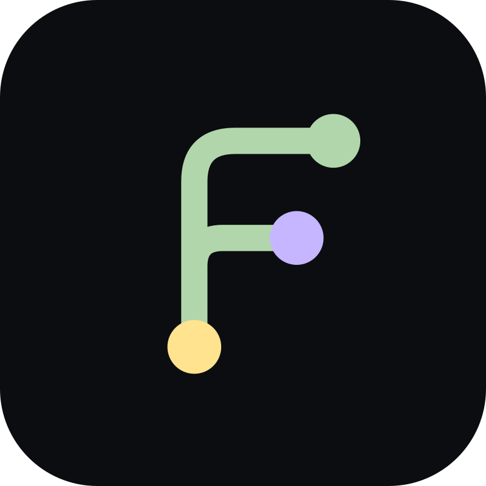
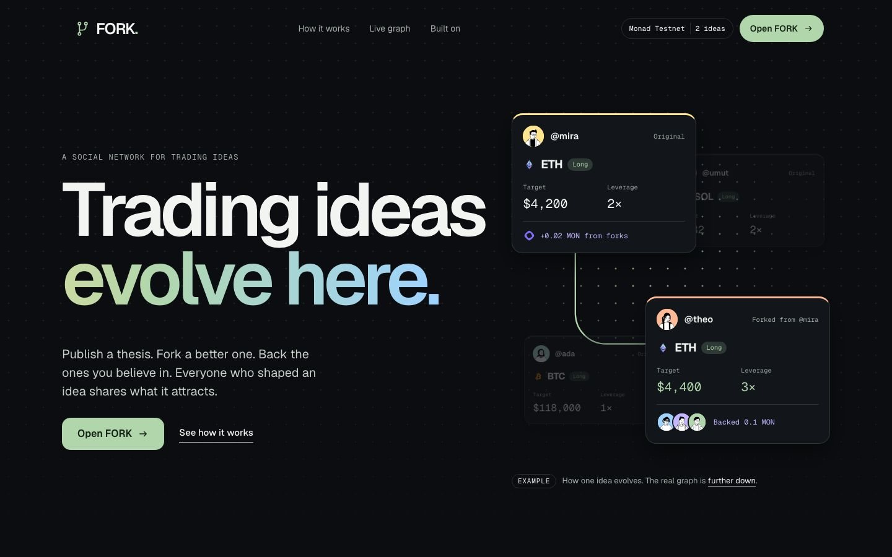
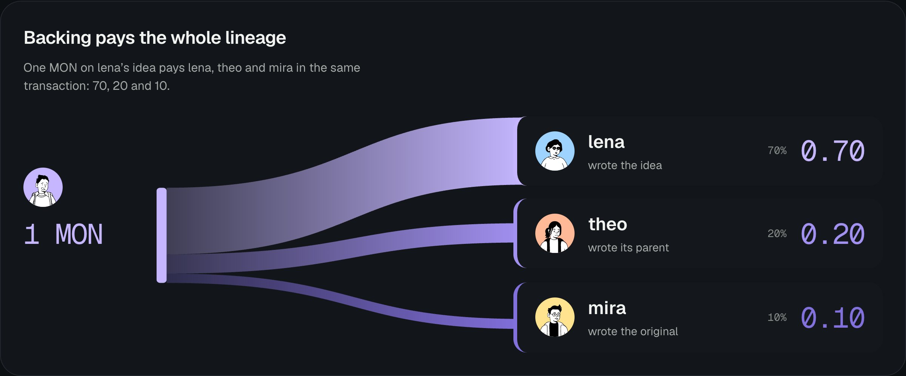

<p align="center">
  
</p>

<h1 align="center">FORK</h1>

<p align="center"><b>Trading ideas evolve here.</b></p>

<p align="center">
Publish a trading idea. Someone forks it into a better one. People back the ideas they believe in,<br>
and every backing is split onchain between everyone who shaped the idea.
</p>

<p align="center">
  <a href="https://forktrades.xyz"><b>Live product</b></a> ·
  <a href="https://forktrades.xyz/t/2/tree">A real Idea Tree</a> ·
  Demo video (link pending) ·
  Founder pitch (link pending) ·
  <a href="https://docsend.com/view/kw962jdfm6pc689r">Pitch deck</a>
</p>

<p align="center">
  Monad Metropolis · Track 03: Social, Attention &amp; Culture · Envio · Privy
</p>

<!-- PENDING: demo video and founder pitch links -->



## FORK in one minute

Trading ideas already live in public, in X threads, Telegram groups and Discord channels. The best part of those threads is usually a reply: a better target, a tighter invalidation, a sharper argument. That reply is gone a week later, and so is the credit of the person who wrote it.

FORK turns an idea into an object with a history. A **fork** is a new idea that keeps a permanent link to the one it improves. A **backing** puts MON behind an idea and, in the same transaction, pays its author and the authors of the ideas it grew from. The **Idea Tree** shows the whole lineage and the value that moved along it.

Authorship, ancestry and the split live in two small contracts on Monad, with no owner, no fee and no upgrade path. Envio indexes them into the one graph the product reads. Privy gives every visitor an account and a wallet with an email code.

A reply in a thread cannot pay the people who shaped an idea. On FORK, that is the default.

## Numbers you can check

Every number in this README comes from a run anyone can reproduce or a record anyone can read.

| What                                                    | Result                                                                               | Where to check it                                                                                                                                                                 |
| ------------------------------------------------------- | ------------------------------------------------------------------------------------ | --------------------------------------------------------------------------------------------------------------------------------------------------------------------------------- |
| A backing, hash returned to first receipt               | **417.5 ms** median, 423 ms p95, 20 real backings                                    | [`docs/MONAD_PERFORMANCE.md`](docs/MONAD_PERFORMANCE.md) and the [raw file](docs/monad-performance/backing-2026-10-13T07-45-23-986Z.json), every sample with its transaction hash |
| The same backing readable from Envio, after the receipt | **580.5 ms** median, 840 ms p95                                                      | Same file                                                                                                                                                                         |
| Gas used by one backing                                 | 78,692, and 154,373 for the first one, which creates the records                     | Same file                                                                                                                                                                         |
| Contract tests                                          | **68** Foundry tests, including fuzzing, reentrancy and a stateful balance invariant | [`docs/FORKBACKING_COVERAGE.md`](docs/FORKBACKING_COVERAGE.md)                                                                                                                    |
| Contract coverage                                       | **100%** of lines, statements, branches and functions, on both contracts             | Same file                                                                                                                                                                         |
| Indexer tests                                           | 26 handler tests on Envio's own test indexer                                         | [`indexer/test/`](indexer/test/)                                                                                                                                                  |
| Application tests                                       | 300 unit and database tests, 23 browser journeys, all run in CI                      | [`.github/workflows/ci.yml`](.github/workflows/ci.yml)                                                                                                                            |
| Landing page, Lighthouse mobile                         | 92 to 93 performance, 100 accessibility, zero layout shift                           | [`docs/DESIGN_QUALITY.md`](docs/DESIGN_QUALITY.md)                                                                                                                                |

Timing figures are wall-clock observations from one machine and one public RPC. They are not claims about consensus or throughput, and nothing here is stated as a cost in money: testnet MON has no price.

## For judges: a five minute tour

Nothing needs an account to read.

1. **Open [forktrades.xyz](https://forktrades.xyz)** and scroll to _What the graph holds right now_. Every figure, node and event in that section is read from the Envio graph for your request, with the time of the read printed under it. The characters in the story above it are labelled examples, and a browser test asserts that none of them ever appears in a live section.
2. **Open [the Idea Tree of #2](https://forktrades.xyz/t/2/tree)**: a real original idea and its fork, published by two different wallets.
3. **Sign in** with Google or an email code. Privy creates your wallet and FORK sends it 0.2 testnet MON, so you can act without a faucet.
4. **Fork an idea.** Change its target or leverage. While you write, FORK shows exactly what differs from the parent.
5. **Back an idea you did not write.** Before you sign, the sheet shows who receives what. After it confirms, it shows the confirmation time measured for your own transaction.
6. **Open your transaction on the explorer.** One `Backed` event, and one `Credited` event for each author paid.
7. **Ask Envio directly.** The endpoint is public and needs no key:

```sh
curl -s https://indexer.dev.hyperindex.xyz/18ce77d/v1/graphql \
  -H 'content-type: application/json' \
  -d '{"query":"{ BackingTotals { totalBacked backingCount supporterCount sentToAncestors } Thesis(order_by: {thesisId: asc}) { thesisId parentId author backing { totalBacked backerCount } } }"}'
```

Detailed steps, limits and fallbacks are in the judge access notes of [`docs/submission/portal-copy.json`](docs/submission/portal-copy.json).

## Where each judging criterion is answered

| Criterion                     | Read this                                                                                      |
| ----------------------------- | ---------------------------------------------------------------------------------------------- |
| Technical execution           | [What lives onchain](#what-lives-onchain-and-why), [Engineering quality](#engineering-quality) |
| Design and craft              | [How it works](#how-it-works), [`docs/DESIGN_QUALITY.md`](docs/DESIGN_QUALITY.md)              |
| Originality and track insight | [The split](#the-split), [Why this needs a chain](#why-this-needs-a-chain)                     |
| Monad integration             | [Why Monad](#why-monad)                                                                        |
| Founder and market readiness  | [Who it is for](#who-it-is-for), [Team](#team)                                                 |
| Traction and path forward     | [Where it stands](#where-it-stands), [Path forward](#path-forward)                             |

## Who it is for

Crypto-native traders and research groups who already explain their ideas in public, and the people who reply with improvements. They have the habit FORK needs. What they lack is a place where an improvement keeps its author and shares in what the idea attracts.

| Today, in a thread                           | On FORK                                                                                               |
| -------------------------------------------- | ----------------------------------------------------------------------------------------------------- |
| An idea is a post that scrolls away          | An idea has a permanent address, an author and a history                                              |
| A better version is a reply that gets buried | A better version is a fork, linked to its parent for good                                             |
| Nobody can say who changed what              | The diff between an idea and its fork is shown and kept                                               |
| Agreement is a like                          | Agreement can be a backing that pays everyone who shaped the idea                                     |
| Reputation is follower count                 | A profile shows original ideas, ideas forked by others, earnings as an author and earnings from forks |

## How it works

### Publish

Write a thesis: market, direction, target, invalidation, leverage and your reasoning. Your wallet signs it and Monad records you as the author. The thesis page puts the two things a reader can do side by side: fork it or back it.


### Fork

Disagree with the target, the leverage or the argument? Fork the thesis and change it. While you write, FORK lists exactly what differs from the parent, and the published fork keeps that link permanently.


### Back

Put MON behind an idea you believe in. Before you sign, the sheet shows who receives what. After it confirms, it shows the confirmation time measured for your transaction and your place among the idea's first ten backers.


### Idea Tree

Every branch of an idea in one view: who wrote each version, what changed, what each version received, and what backing of its forks sent back to it.


### Profile

A profile answers what a reputation should: how many original ideas, how many were forked by other people, what was earned as an author, what arrived from other people's forks, and which ideas this person backed early. Claimable earnings are withdrawn with one signature.


_The four screenshots above come from the isolated test workspace, which is labelled in its top bar and uses test identities. The landing page images come from the live product._

<!-- PENDING: replace the four test workspace screenshots with live captures after the demo recording -->

## The split



`back(thesisId)` reads the lineage from the registry, at most three entries, and credits in the same transaction:

| Backed idea      | Its author | Parent's author | Grandparent's author |
| ---------------- | ---------- | --------------- | -------------------- |
| An original idea | 100%       |                 |                      |
| A fork           | 80%        | 20%             |                      |
| A fork of a fork | 70%        | 20%             | 10%                  |

- The credits of one backing always sum to the amount sent. Rounding dust goes to the author.
- One address in several roles is credited once, in its nearest role. Forking your own idea never produces income labelled as earned from forks.
- Credits are balances, not transfers. Each author collects with `withdraw()`, so nobody can block a backing by refusing to receive it.
- The first ten distinct backers of an idea are recorded as its early supporters, in arrival order.
- The minimum backing is 0.01 MON, and an author cannot back their own idea from the authoring address.
- `previewSplit` returns exactly what `back` would record, and the Back sheet shows it before the user signs.

Originating an idea and improving one are paid by the same public rule. That is the product's core claim, and it is enforced by code nobody can change.

## What lives onchain and why

Two contracts on Monad Testnet (chain 10143), both source verified on Sourcify with an exact match. Neither has an owner, an admin, a fee or an upgrade path.

| Contract       | Address                                                                                                                            | What it holds                                                                                                                        |
| -------------- | ---------------------------------------------------------------------------------------------------------------------------------- | ------------------------------------------------------------------------------------------------------------------------------------ |
| `FORKRegistry` | [`0x1889a7216b1ecad9a44910dd0996834d0894b9e1`](https://testnet.monadvision.com/address/0x1889a7216b1ecad9a44910dd0996834d0894b9e1) | Every thesis: author, parent, market, direction, target, invalidation, leverage, creation time and the hash of its written reasoning |
| `FORKBacking`  | [`0x832ca98b0dbd94caa0f3d3e06ea658284cc39f8f`](https://testnet.monadvision.com/address/0x832ca98b0dbd94caa0f3d3e06ea658284cc39f8f) | Backing of a thesis, the split along its lineage, early supporter positions and each author's claimable balance                      |

| Transaction                              | Hash                                                                                                                           |
| ---------------------------------------- | ------------------------------------------------------------------------------------------------------------------------------ |
| Registry deployment                      | [`0xc1ba5d4f…5fbf4a86`](https://testnet.monadvision.com/tx/0xc1ba5d4fc31bc0a45e973ec8a63c0583a3fb4f643c0f46053a7ee5dd5fbf4a86) |
| Thesis #1 published                      | [`0xbcbfa028…630a090f`](https://testnet.monadvision.com/tx/0xbcbfa028b4078a97cf1198d4ffac2f61691d8ac0607b43a006a6595b630a090f) |
| Thesis #2 forks #1, from a second wallet | [`0xe5fbf9c8…8ab6b192`](https://testnet.monadvision.com/tx/0xe5fbf9c835109a566be8afebd5c2d146731d1f998851ea1875798e328ab6b192) |
| Backing deployment, block 70423451       | [`0xb4cf544e…3f9a5660`](https://testnet.monadvision.com/tx/0xb4cf544e5b0e534ea3f71ec863b4fc4c3d88d1901d34e22d65c9bf753f9a5660) |
| First backing, of thesis #3              | [`0x5ee9a84a…20293d88`](https://testnet.monadvision.com/tx/0x5ee9a84a55d6bbef1f4254a5bc6394c0852d786f4a36987725f51c0e20293d88) |

**What stays offchain.** The written reasoning, tags, comments and Agree reactions are in PostgreSQL. The reasoning is anchored: its hash is in the registry, and the product does not show text that fails to match it.

Specification: [`docs/08_SMART_CONTRACT_SPEC.md`](docs/08_SMART_CONTRACT_SPEC.md). Deployment records with bytecode hashes and verification results: [`contracts/deployments/`](contracts/deployments/).

## Why this needs a chain

If authorship, ancestry and the split lived in our database, credit would depend on us. We could reorder a lineage, drop an author or change a percentage, and nobody could tell.

Here the same public record that says who wrote an idea also decides who is paid when it is backed. The rule is in a contract with no owner, so it applies to us exactly as it applies to everyone else, and anyone can check it without asking FORK. The chain is not decoration: remove it and the product's promise disappears.

## Why Monad

Backing is a social gesture, like agreeing with a post, except that it moves value: one call credits up to three authors and changes the public graph. It only feels like a gesture if it is over while the sheet is still open.

On Monad Testnet it is. Across 20 real backings, the first receipt arrived **417.5 ms** after the hash at the median, and Envio served the backing **580.5 ms** after that. A backing is confirmed and in everyone's graph about a second after the wallet sends it.

Two parts of the design depend on that:

- **Small and frequent.** Backing starts at 0.01 MON, with presets of 0.05, 0.1 and 0.25 MON. An idea is meant to collect many small backings from many people.
- **Settled at the moment of backing.** `back` reads the lineage and credits every author in the same transaction. Nothing is batched or settled later, so the tree shows value arriving at an ancestor as soon as the backing is confirmed and indexed.

FORK also measures this for every user: each publish, fork and backing shows the confirmation time of that exact transaction, timed in the browser from the hash to the first receipt. Method and limits: [`docs/MONAD_PERFORMANCE.md`](docs/MONAD_PERFORMANCE.md).

## Built with Envio

Envio HyperIndex turns the events of both contracts into one graph, and that graph is what the product reads: the feed, thesis pages, the Idea Tree, profiles and the live section of the landing page. The app never rebuilds these aggregates from raw logs.

| Contract       | Events indexed                     |
| -------------- | ---------------------------------- |
| `FORKRegistry` | `ThesisCreated`, `ExecutionLinked` |
| `FORKBacking`  | `Backed`, `Credited`, `Withdrawn`  |

| Entity                                                        | What it powers                                                                                               |
| ------------------------------------------------------------- | ------------------------------------------------------------------------------------------------------------ |
| `Thesis`, `ForkEdge`                                          | Feed, thesis pages and the tree: parent, root, depth and fork counts                                         |
| `AuthorStats`, `ThesisExternalForker`, `AuthorExternalForker` | Profile reputation: ideas forked by other people, and the distinct people who forked them, each counted once |
| `MarketStats`                                                 | Counts per market                                                                                            |
| `Backing`, `Credit`, `Withdrawal`                             | One record per backing, per credit and per withdrawal                                                        |
| `ThesisBacking`                                               | A thesis's total, its backer count and its first ten backers, on cards, thesis pages and tree nodes          |
| `Supporter`                                                   | A profile's early support and total backed                                                                   |
| `AuthorEarnings`                                              | Earnings as author, earnings from forks, withdrawn and claimable amounts                                     |
| `LineageFlow`                                                 | The value that backing of one thesis sent to each ancestor, drawn on the tree                                |
| `BackingTotals`                                               | The landing page's live figures                                                                              |

**Where the two contracts meet.** Backing entities live in the registry's namespace, and `ThesisBacking` shares its id with its `Thesis`, so one query returns an idea together with everything it has received. Roles come straight from the contract's events, so a self-fork yields no fork earnings and no flow without a special case in the indexer.

Config: [`indexer/config.yaml`](indexer/config.yaml) · Schema: [`indexer/schema.graphql`](indexer/schema.graphql) · Handlers: [`registry.ts`](indexer/src/handlers/registry.ts), [`backing.ts`](indexer/src/handlers/backing.ts) · Tests: [`indexer/test/`](indexer/test/) · Public endpoint: [`https://indexer.dev.hyperindex.xyz/18ce77d/v1/graphql`](https://indexer.dev.hyperindex.xyz/18ce77d/v1/graphql)

## Built with Privy

Privy is the account and the wallet. A visitor needs neither a browser extension nor a seed phrase, and everything they author is signed by their own wallet.

- **Sign in** with Google, or email and a one-time code. Either method can be added to the other later from the wallet panel.
- **An embedded wallet for everyone**, created at first sign-in, on Monad Testnet only. It belongs to the user, who can export its key.
- **Gas without a faucet visit.** After a verified sign-in, FORK sends a one-time welcome drip of 0.2 testnet MON: one per user and per wallet, at most 15 a day. When the faucet is empty, the product says so and points to the public Monad faucet.
- **A chosen handle**, tied to the Privy identity on the server. The profile lives at `/u/handle`.
- **Wallet-signed actions.** Publishing, forking, backing and withdrawing are transactions from the embedded wallet, approved in Privy's prompt. The wallet's address is the onchain author and the account that earns.
- **Verified on the server.** Every write is checked against the Privy access token and the wallets Privy lists for that identity. The server never holds a user's key.

Details and limits: [`docs/14_PRIVY_INTEGRATION.md`](docs/14_PRIVY_INTEGRATION.md). The faucet's threat model is T13 in [`docs/16_SECURITY_THREAT_MODEL.md`](docs/16_SECURITY_THREAT_MODEL.md).

## Architecture


| Layer               | Technology                                                                                                                                                                                         |
| ------------------- | -------------------------------------------------------------------------------------------------------------------------------------------------------------------------------------------------- |
| Contracts           | Solidity 0.8.37, Foundry 1.8.4, Monad Testnet                                                                                                                                                      |
| Indexing            | Envio HyperIndex 3.12.1 on Envio Cloud, read over GraphQL                                                                                                                                          |
| Sign-in and wallets | Privy React 3.47.0 and Privy Node 0.35.0                                                                                                                                                           |
| Web                 | Next.js 16.3.8 App Router, React 19.3.0, TypeScript 5.9.3 in strict mode, Tailwind CSS 4.3.3, TanStack Query 5.104.1, viem 2.57.2, Motion 14.1.0, GSAP 3.15.0 and Lenis 1.3.26 on the landing page |
| Data                | PostgreSQL 17 through node-postgres and Drizzle ORM, with committed migrations                                                                                                                     |
| Tests               | Foundry, Vitest, Envio's test indexer, Playwright                                                                                                                                                  |
| Hosting             | Self-hosted Node.js behind Caddy with HTTPS. The application and database ports are private                                                                                                        |

The wallet signs directly to the contracts. The server verifies the Privy identity and its linked wallets before accepting any write, and checks a new thesis against its receipt on Monad before recording it as published.

## Engineering quality

**Contracts.** 68 Foundry tests with 100% line, statement, branch and function coverage on both contracts. They cover every revert, every lineage depth, every case where one address holds several roles, rounding, reentrancy on `withdraw`, and MON forced into the contract. Four fuzz tests run 256 times each. A stateful invariant runs six actors publishing, forking, backing and withdrawing in random order, 12,288 calls, and checks after every call that the contract's balance equals the sum of unwithdrawn credits.

**Safety by construction.** No owner, no admin, no fee and no upgrade path. Pull payments instead of pushes, so a recipient cannot block a backing. A balance is set to zero before value is sent. The backing contract reads only author and parent from the registry.

**Honesty enforced by tests.** The landing page separates illustration from data in code: live sections render only what the indexer returned for the request, events appear only for ideas whose reasoning passed its hash check, fewer than six events never loop, and a browser test fails if an example character appears in a live section. No timing figure can render unless it comes from the recorded run.

**Product.** 300 unit and database tests and 23 browser journeys cover sign-in, the handle, the welcome drip and an empty faucet, publishing, forking, backing, withdrawing, the tree and profiles. The landing page renders completely without JavaScript and with reduced motion.

**Process.** Every decision with its reasons is in [`docs/29_DECISIONS.md`](docs/29_DECISIONS.md), from D-001 to D-060. Lint, type checks and every test suite run in CI on each push.

## What FORK deliberately does not do

- **It does not trade.** FORK places no orders and holds no positions. Trading is what the ideas are about. The product is the social graph around them.
- **It has no token** and none is planned for this stage.
- **It takes no fee.** The backing contract sends every unit to authors.
- **It does not invent activity.** No seeded users, no padded counters, no simulated feed on the live product.

## Where it stands

FORK is live at [forktrades.xyz](https://forktrades.xyz) on Monad Testnet, with every flow working end to end: sign-in, wallet, welcome drip, handle, publish, fork, back, Idea Tree, profile and withdraw.

The live graph is early and small, and it consists of the team's own test activity, including the 20 backings of the measurement run. The landing page states this in plain words and prints exactly what the graph holds at the moment you read it. Nothing here is evidence of adoption or of trading performance.

## Path forward

Nothing in this section has happened yet. It is the plan, in order.

1. **A first cohort by direct outreach.** Turkish university blockchain communities and trading groups, reached one group at a time. Anıl founded and led one such community for three years, which is why the outreach starts there. No partnership exists today, and none is claimed.
2. **Onboard creators, not accounts.** Each one claims a handle, publishes one idea they would defend, shares its link where they already post, and invites one person to fork it. A thesis link is readable without an account.
3. **Measure three things,** all read from the public graph so anyone can check them: forks per original idea, contributors who return to fork or publish again, and backing per active idea. If forks do not happen, backing does not matter.
4. **Then mainnet,** only after the cohort shows that people fork and come back.

## Team

**Anıl Karaçay**, founder of Cayvox Labs (Istanbul, blockchain infrastructure), system architect and developer. Founded the Çankaya University Blockchain Community in 2021 and led it for three years. Previously worked on payments, digital assets and tokenization at companies including Colendi, Goldtag and Bitci.

GitHub: [anilkaracay](https://github.com/anilkaracay)

## Run it locally

<details>
<summary><b>1. Isolated workspace, no credentials</b></summary>

<br>

Labelled test identities and simulated confirmations, with every event replayed through the real indexer handlers. It needs no Privy, database or chain access, and it proves nothing about the live providers.

Prerequisites: **Node 24.21.0**, **pnpm 12.6.0**, Git and the usual build tools. Docker is needed for a local PostgreSQL, Playwright needs its browser, and the Foundry installer supplies the pinned contract tools.

```sh
git clone https://github.com/anilkaracay/fork-metropolis.git
cd fork-metropolis
pnpm install --frozen-lockfile
pnpm tools:install
pnpm --filter @fork/web exec playwright install chromium
pnpm test
pnpm lint
pnpm typecheck
pnpm test:e2e
```

For an interactive workspace, run `pnpm test:dev` and open `http://localhost:3000`. Choose a test identity in the bar at the top; "Dana · new account" walks through the handle and the welcome drip. Production rejects this mode.

</details>

<details>
<summary><b>2. Real development integration</b></summary>

<br>

```sh
cp apps/web/.env.example apps/web/.env.local
pnpm db:up
pnpm db:migrate
pnpm db:smoke
pnpm dev
```

`db:up` generates a local password and writes the connection string into the ignored `.env.local`. Use the committed migrations, never a schema push. Then set:

| Variable                                       | Purpose                                                              |
| ---------------------------------------------- | -------------------------------------------------------------------- |
| `NEXT_PUBLIC_PRIVY_APP_ID`, `PRIVY_APP_SECRET` | Your Privy app, with `http://localhost:3000` as an allowed origin    |
| `FORK_REGISTRY_ADDRESS`                        | The registry address above                                           |
| `FORK_ENVIO_URL`                               | The GraphQL endpoint above                                           |
| `FORK_BACKING_ADDRESS`                         | The `FORKBacking` address above. Without it, backing is switched off |
| `FORK_FAUCET_PRIVATE_KEY`                      | Optional. A testnet-only key for the welcome drip                    |

Never place a server secret in a `NEXT_PUBLIC_*` variable. See the [environment example](apps/web/.env.example), the [testing guide](docs/17_TESTING_QA.md) and the [deployment guide](docs/23_DEPLOYMENT_ENV.md).

</details>

<details>
<summary><b>3. Test suites</b></summary>

<br>

| Suite            | Command                                                                                 | What it covers                                                                                  |
| ---------------- | --------------------------------------------------------------------------------------- | ----------------------------------------------------------------------------------------------- |
| Contracts        | `pnpm test:contracts`                                                                   | 68 Foundry tests. `pnpm test:contracts:coverage` reports coverage                               |
| Indexer          | `pnpm test:indexer`                                                                     | 26 handler tests on Envio's test indexer                                                        |
| Application      | `pnpm test:unit`                                                                        | 300 unit and database tests                                                                     |
| End to end       | `pnpm test:e2e`                                                                         | 23 browser journeys in the isolated workspace                                                   |
| Production build | `pnpm --filter @fork/web exec playwright test --config playwright.production.config.ts` | Smoke tests of the production build. Cases that need indexed ideas run with `FORK_SMOKE_LIVE=1` |

</details>

## Repository map

| Path                                   | What is there                                                                                      |
| -------------------------------------- | -------------------------------------------------------------------------------------------------- |
| [`contracts/`](contracts/)             | `FORKRegistry`, `FORKBacking`, their tests and deployment records                                  |
| [`indexer/`](indexer/)                 | Envio config, schema, handlers and tests                                                           |
| [`apps/web/`](apps/web/)               | The Next.js product, its API and its browser tests                                                 |
| [`packages/shared/`](packages/shared/) | Thesis encoding, content hashing, the split preview and handles, shared by the app and the tests   |
| [`packages/db/`](packages/db/)         | PostgreSQL schema and committed migrations                                                         |
| [`docs/`](docs/)                       | Product, design, engineering and decision records. Start at [`docs/00_INDEX.md`](docs/00_INDEX.md) |

## Build notes

- **Build window.** The repository history begins on October 4, 2026, inside the Monad Metropolis build window.
- **External code.** Frameworks, libraries, provider services, fonts and artwork keep their own licenses and are listed in [`THIRD_PARTY_NOTICES.md`](THIRD_PARTY_NOTICES.md).
- **AI assistance.** AI coding assistants were used during development. All product, architecture and design decisions were made and reviewed by the author.
- **License.** FORK's source is available under the [MIT License](LICENSE).

FORK runs on Monad Testnet. Testnet MON has no monetary value, and ideas on FORK are opinions, not financial advice.
