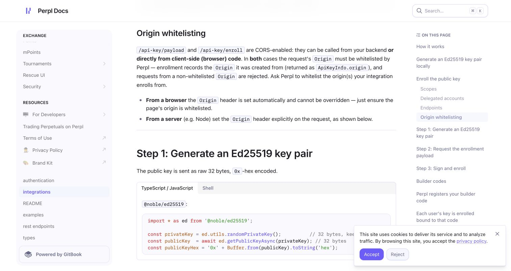
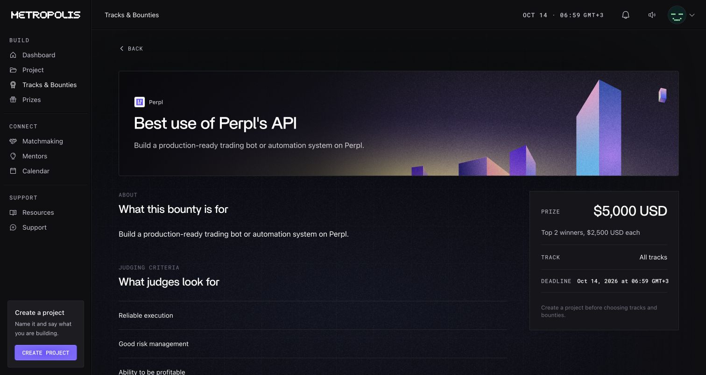

# Perpl — BLOCKED / DEFERRED

## Current priority — 2026-10-11

**PERPL: BLOCKED / DEFERRED — EXTERNAL ORIGIN APPROVAL PENDING.** Explicit user decision D-051 supersedes the historical next action and gate sequence below: do not wait for or pursue Perpl now. Continue Stage A product/landing research only. Existing implementation and evidence remain intact. No real execution, Verified status, execution reputation credit or Perpl bounty eligibility is claimed. Nansen stays deferred. No provider contact or human action is required for the current art-direction gate.

The remaining sections are the preserved pre-deferral checkpoint, not the current work order.

Checkpoint: 2026-10-11. REAL PERPL EXECUTION + AUTHORITATIVE VERIFICATION is incomplete. Prior public deployment remains approved.

## Current official preflight

Re-read official [API README](https://github.com/PerplFoundation/api-docs/blob/main/README.md), [enrollment](https://github.com/PerplFoundation/api-docs/blob/main/integrations.md), [authentication](https://github.com/PerplFoundation/api-docs/blob/main/authentication.md), [REST](https://github.com/PerplFoundation/api-docs/blob/main/rest-endpoints.md), [WebSocket](https://github.com/PerplFoundation/api-docs/blob/main/websocket.md), [types](https://github.com/PerplFoundation/api-docs/blob/main/types.md), and [Networks & Configuration](https://github.com/PerplFoundation/perpl-docs/blob/main/docs/resources/for-developers/networks-and-configuration.md). Sanitized runtime/probe evidence: [perpl-preflight.json](perpl-preflight.json).

- Chain 10143, instance 12; exchange `0x1964c32f0be608e7d29302aff5e61268e72080cc`.
- Active collateral AUSD `0xa9012a055bd4e0edff8ce09f960291c09d5322dc`, 6 decimals; account-opening minimum 100 AUSD, subsequent-deposit minimum 10 AUSD. Current network guide agrees with live context; the API README lists an inconsistent older token.
- Eight open markets: BTC 16, ETH 32, SOL 48, MON 64, ZEC 256, LIT 272, PUMP 320, NEAR 336. MVP symbols stay BTC/ETH/SOL/MON. ETH size precision is 3 decimals; this alone does not prove practical size or fillability.
- Enrollment does not create an exchange account. Exact collateral approval and `createAccount(uint256 amountCNS)` are required; new accounts have forwarding disabled. Wallet-authorized `allowOrderForwarding(true)` enables API orders. Read actual `as[].fw` from the authoritative wallet snapshot.
- Client-local Ed25519 enrollment uses wallet EIP-712 signature and Ed25519 PoP over its digest. REST signatures bind chain/method/exact target/timestamp/single-use nonce/body SHA-256. Perpl documents a 30-second window; FORK's existing boundary is stricter. No private signing key belongs on the server.
- Current docs support WS and POST `/api/v1/trading/orders`. ACK is not fill. Preserve original request IDs on uncertain retries and reconcile authoritative state. The server verification relay remains GET-only wallet/fills, never order/cancel/withdraw.
- Account/order IDs are uint64 numbers; preserve integers losslessly. `at.l` is documented as transaction-local log index. Validate actual receipt correspondence before using real evidence. v1 encoding is unchanged.
- No supported collateral funding transaction/faucet has been used or proven for User A. Funding-method investigation must finish before any deposit; no unofficial token/faucet is allowed.

## Proven Origin blocker

[Official requirements](https://docs.perpl.xyz/integrations#origin-whitelisting) require provider approval for browser and server enrollment. The documented process is to ask Perpl; the reviewed API has no self-service Origin-registration endpoint.

| Identical unsigned payload, different Origin         | Result                                    |
| ---------------------------------------------------- | ----------------------------------------- |
| `https://forktrades.xyz`                             | HTTP 400, generic Bad Request; no payload |
| `https://testnet.perpl.xyz`, diagnostic control only | HTTP 200; payload available               |

The input used the existing public User A wallet and a public RFC test-vector key. No private key, wallet signature, enrollment, API credential or order was created. Control-response typed data/MAC stayed only in memory and was discarded without printing or saving. It cannot be used as a substitute FORK Origin. OPTIONS returned 404 without allow-origin; that alone was not treated as proof.

Single required action: have Perpl whitelist `https://forktrades.xyz` for Testnet programmatic API-key enrollment through the official [Perpl Discord](https://discord.gg/perpl), then confirm completion. This contact link comes from live Perpl public context. No message, join or builder-fee registration was made by the agent.

## Gate report

| Requested field               | Result                                                                                                                                                                                                                                                     |
| ----------------------------- | ---------------------------------------------------------------------------------------------------------------------------------------------------------------------------------------------------------------------------------------------------------- |
| 1. PERPL STATUS               | BLOCKED at Origin approval.                                                                                                                                                                                                                                |
| 2. ORIGIN                     | Production origin rejected in unsigned payload probe.                                                                                                                                                                                                      |
| 3. ACCOUNT                    | Expected User A wallet `0xe281d002b4c2d0cf2cc2edfd1b3b57045101aba4`. Production browser displays authenticated User A; previous private DID/wallet proof remains approved. Perpl account and enrollment not inspected/performed beyond the unsigned probe. |
| 4. COLLATERAL                 | Context/minima verified above; wallet balance and official funding method unproven. No funding used.                                                                                                                                                       |
| 5. EXECUTION                  | No trade. Intended candidate: author's thesis #1, ETH 32/Long, conservative leverage; size unselected. No request/order/fill ID created.                                                                                                                   |
| 6. AUTHORITATIVE VERIFICATION | GET wallet/fills documented; authenticated relay transport/evidence writer remains disabled.                                                                                                                                                               |
| 7. EXECUTION REF              | v1 unchanged; static vectors pass. No real fillIdentity/executionRef derived.                                                                                                                                                                              |
| 8. MONAD LINK                 | No transaction/event/new link.                                                                                                                                                                                                                             |
| 9. ENVIO                      | No execution link; execution latency unmeasured. Existing graph smoke passes.                                                                                                                                                                              |
| 10. PRODUCT                   | No execution status or reputation credit added. Root execution alone is not a strict-descendant execution for Executions Inspired.                                                                                                                         |
| 11. SECURITY                  | No real Perpl signing keys/credentials created or signed auth material retained. No Cherry/Caddy/env/application-code changes.                                                                                                                             |
| 12. PERPL BOUNTY              | NOT ELIGIBLE: current mandatory bot/automation deliverable is not met by manual execution.                                                                                                                                                                 |
| 13. TEST RESULTS              | 53 selected context/relay/ref/fill-adapter tests pass; public product/database smoke passes. Live enrollment/signing/verification/link/indexing and full completion checks remain pending.                                                                 |
| 14. FILES CHANGED             | This report, integration spec, decision log, sanitized JSON and two public provider screenshots.                                                                                                                                                           |
| 15. HUMAN ACTION REQUIRED     | Single provider Origin action above.                                                                                                                                                                                                                       |
| 16. NEXT RECOMMENDED STEP     | Resume this gate after whitelisting. FINAL SUBMISSION POLISH only after real execution gate completion; unstarted.                                                                                                                                         |

## Current bounty evidence

Read authenticated official [Best use of Perpl's API](https://hackathon.monad.xyz/tracks/best-use-of-perpl-s-api) detail on 2026-10-11 through the existing GitHub session. Mandatory deliverable remains a production-ready bot/automation with demonstrated onchain activity. Judging includes reliability, risk management and profitability. The suggested social-interface idea does not remove the mandatory deliverable. No project creation, bounty selection or submission was made.

